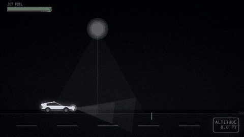
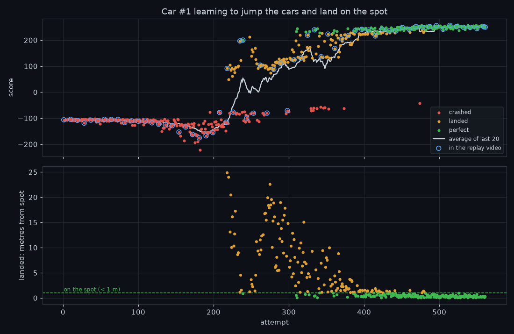

# Tesla Roadster Landing

**A jet-pack Tesla Roadster teaches itself to jump over parked cars, a Cybertruck and a semi truck, and land on an exact spot. It uses reinforcement learning (Gymnasium + PPO).**



Nobody programs the flight. The AI starts out pressing random controls and crashes hundreds of times. It gets a score for every attempt and gradually learns what earns points: build up speed, lift off, clear the semi truck, come down gently, and touch down on the spot.

| | Result |
|---|---|
| Training time | ~3 minutes on a laptop CPU (Apple M1), 2M simulation steps |
| Test: 20 fresh attempts | **20 / 20 landed, 20 / 20 within 1 m of the spot** |
| Average distance from the spot | **0.12 m** |
| The original scripted pilot | lands, but 23 m past the spot |

## Quick start

You need **Node.js 16+** and **Python 3.10+**.

```bash
git clone https://github.com/Vinaychauhan06/tesla-roadster-landing.git
cd tesla-roadster-landing
npm run setup     # once: makes .venv/ and installs the Python packages (PyTorch is large)
npm run demo      # the trained AI: 20-attempt test + renders car_jump_ai.gif
npm run watch     # train it yourself and watch every attempt animate live
```

## Commands

| npm | What it does |
|---|---|
| `npm run setup` | Creates `.venv/` and installs the packages in `requirements.txt` |
| `npm run demo` | Tests the included trained model over 20 attempts and renders `car_jump_ai.gif` |
| `npm run test` | Just the 20-attempt test |
| `npm run train` | Trains from scratch. Prints every attempt of car #1 (observations, actions, reward) and its result |
| `npm run watch` | Same, plus a **live animation window** that plays every attempt as training runs |
| `npm run flip` | Experimental: tries to teach a full mid-air flip before landing (see below) |
| `npm run view` | Re-plays a run's logged attempts as the live animation |
| `npm run replay` | Renders `learning_replay.mp4` (attempts in order) and `logs/learning_curve.png` |
| `npm run video` | After training: a ~45 s square video for LinkedIn/Instagram (`roadster_video.mp4`). It picks real attempts from your run (crashes, first landing, closer, best landing) and ends with a 20-attempt test. Add `-- --reel` for a vertical 1080×1920 Reel/TikTok/Short, and `--cta "DM me ROADSTER"` for your own end-card call to action |
| `npm run scripted` | The original hand-written pilot, rendered to `car_jump.gif` |

Pass extra options after `--`:

```bash
npm run train -- --target 80              # land on a different spot
npm run train -- --steps 3000000          # train longer
npm run view -- --from-attempt 300        # re-watch from attempt 300
npm run demo -- --name jump_t67_s0        # test + GIFs of your own run instead of the pretrained one
```

You can also run the Python scripts directly with `.venv/bin/python train_jump.py --watch` and so on.

## Watching it learn

`npm run watch` shows each attempt as it happens:
- **Terminal:** every 25 frames of car #1, its 13 observations, the 3 actions it chose and the reward, then the result:
  ```
  === car #1  attempt 3  [0.00M steps] ===
    frame |   x     y    vx    vy  tilt  spin road fuel spot | thrtl thrst torq | reward   score
        1 |   0.0  0.00   0.0   0.0     0   0.0  1  1.00  67.0 |  0.07  0.56  0.81 |  -0.05    -0.1
       22 |   0.2 -0.00   0.5  -0.8   -18  -1.0  0  0.99  66.8 | -0.37  0.78  1.00 | -100.46  -105.8
    >>> CRASHED  score -105.8  frames 22  ended at x=0.2 m   | last 100 attempts (all cars): avg -106.4, landed 0, on spot 0
  ```
- **Animation window:** the same attempt drawn from those physics numbers, with the score, the live physics, and LANDED or CRASHED plus the reason ("hit the semi truck", "flew off", ...).
- **Logs:** `logs/attempts.csv` holds every attempt of all 16 cars. `logs/frames_car1.csv` holds every frame of car #1.

How one training run went:



| Attempts (car #1) | What it did |
|---|---|
| 1–180 | Lifts off at the start line and falls back onto the road |
| 190–217 | Learns to fly over everything, but never comes down |
| 218 | First landing, 24.9 m from the spot |
| 239 | First landing on the spot (0.8 m) |
| 280–380 | Clears every vehicle; the miss shrinks from ~19 m to ~2 m |
| 388+ | Lands on the spot almost every time (0.0–0.9 m) |

The full replay of 66 attempts in order is in [`assets/learning_replay.mp4`](assets/learning_replay.mp4).

## How it works

**The environment** (`car_jump.py`, a [Gymnasium](https://gymnasium.farama.org/) `gym.Env`, registered as `CarJump-v0`) runs simple 2-D physics at 50 steps per second. On the road the car accelerates. Firing the jets above 0.7 lifts it off. In the air, thrust pushes along the car's tilt, gravity pulls down, and torque spins it.

**What the AI sees** (13 numbers): position, height, horizontal and vertical speed, tilt (as sin/cos), spin, whether it's on the road, fuel, and the distances to the launch line, the parked cars, the landing zone and the landing spot.

**What it controls** (3 numbers per step): throttle, jet thrust, tilt torque.

**The reward:**
- Each step pays the *improvement* in "how good is this position" (closer to the spot, slower, level), like Gymnasium's Lunar Lander. Hovering in a nice place earns nothing.
- −0.05 per step (waiting costs something) and −0.3 × thrust (fuel).
- **−100** for a crash: hitting a vehicle, coming down before the landing zone, landing tilted or too hard, or flying off.
- **+100** for a safe landing, plus **up to +100 more** the closer it is to the spot (full bonus at 0 m, none beyond 6 m).

**The learner:** [Stable-Baselines3](https://stable-baselines3.readthedocs.io/) PPO with a small two-layer network (`MlpPolicy`), 16 cars practising in parallel.

### Lessons learned (reward shaping)

- **The original environment returned a reward of 0**, so there was nothing to learn from. Everything above had to be added.
- **The car could drive straight through the parked cars** on the road, because collisions were only checked in the air. That's fixed now. Otherwise the AI would have found that shortcut.
- **Paying for distance along the road only** made the car fly over the spot high up and leave the scene. Paying for the straight-line distance *to the spot on the ground* taught it to come down.
- **Flip mode found a loophole:** paying for turning even when it crashed meant "flip and crash" (+25) beat "don't try" (−100). Taking the turning credit back on a crash closed it. The AI then learned that the safest high score is to skip the flip entirely. A mid-air flip with downward-only jets is genuinely hard. `npm run flip` is the experiment to keep tuning.

## Files

| File | Purpose |
|---|---|
| `car_jump.py` | Environment, reward, the original scripted pilot, and the animation renderer (night scene, jets, smoke, bloom) |
| `train_jump.py` | PPO training, the per-attempt terminal log, CSV logs, snapshots, `--watch`, `--flip` |
| `live_view.py` | Live animation window that plays every logged attempt during or after training |
| `replay_attempts.py` | Replay video of chosen attempts, plus the learning-curve chart |
| `make_jump_gifs.py` | 20-attempt test and GIF rendering of a trained model |
| `make_video.py` | Social-media video from a training run. Adds crash effects (blast, flash, shake, tumbling wreck, fire) for the video only: in the simulation an attempt simply ends at the impact |
| `cli.js`, `package.json` | The npm commands |
| `models/pretrained_t67.zip` | The included trained AI (landing spot at x = 67 m). Training never overwrites it: your runs save as `models/jump_t<spot>_s<seed>_final.zip` |

## Credits

The environment, scripted pilot and animation are based on *"Car jet-pack jump over cars: GIF code"* (@Vinay). The reinforcement-learning approach follows Gymnasium's Lunar Lander and the Hugging Face Deep RL course.

*A fan project, not affiliated with or endorsed by Tesla, Inc. "Tesla", "Roadster" and "Cybertruck" are trademarks of Tesla, Inc.*
